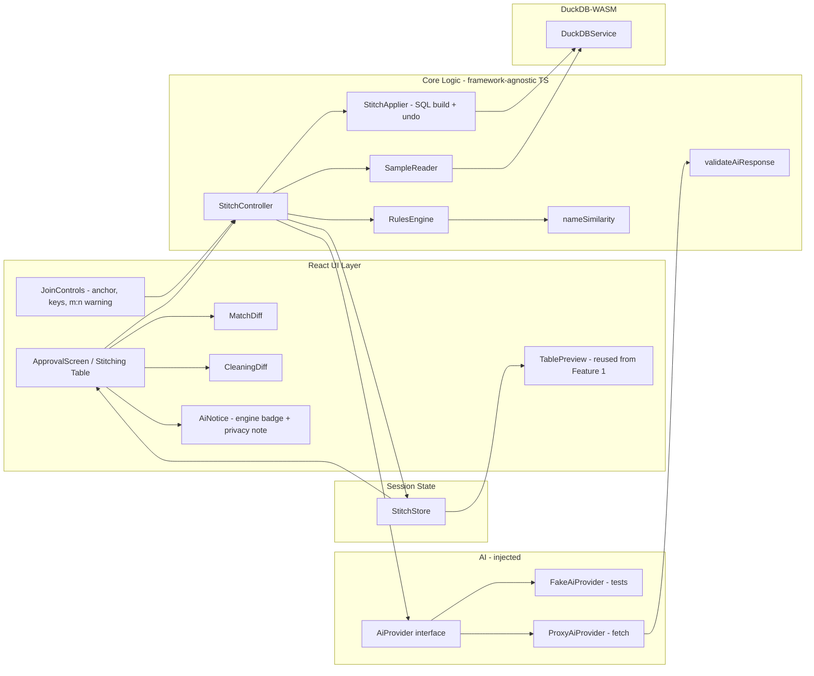

# Design Document — FrankenData AI Stitching and Cleaning

## Overview

This document describes the architecture and design for **Feature 2: AI Stitching and Cleaning** of FrankenData, the client-side mad-scientist lab app for the Kiroween 2026 hackathon. Feature 1 (file intake) already loads messy CSV/XLSX files into typed, in-memory DuckDB-WASM tables (`LoadedTable` descriptors in `src/core/types.ts`). This feature adds the "stitching" stage: when two or more tables are loaded, the app proposes how to join them and how to clean them, shows every proposal as a before/after diff, and applies nothing until the user approves. Applying creates new DuckDB tables, never destroys originals, and is fully undoable. After approval a joined `StitchedTable` is created and shown with the existing `TablePreview`.

All proposals come from a **deterministic, fully offline rules engine**. An **optional LLM enhancement** behind an `AiProvider` interface — reached only through a serverless `AiProxy` — may refine match scores and reasons, but the app never depends on it: any failure silently falls back to the rules engine with a small notice.

Everything runs in the browser. There is no persistence; DuckDB-WASM stays served locally (no CDN). Chat, charts, and export are out of scope and belong to a later spec.

## Goals and Scope

**In scope:**
- Cross-table column matching for every unordered pair of loaded tables, with a `ConfidenceScore` (0–1) and one-line reason per `MatchProposal`, computed from fuzzy name similarity, type compatibility, and value overlap.
- Per-table cleaning proposals: whitespace/case normalization, category standardization, duplicate-row flagging/removal (cleaned copy only), and number-column outlier flagging (adds an `is_outlier` column; removes no rows).
- An approval screen rendering every proposal as a before/after diff, with per-proposal approve/reject/edit, "approve all high-confidence", and a confirm-to-apply `StitchPlan`.
- Non-destructive apply (new `stitch_`-prefixed tables) and single-step undo that provably leaves originals untouched.
- A LEFT JOIN chain producing a `StitchedTable`, shown via the existing `TablePreview`.
- An optional `AiProvider` + `AiProxy` with hardened limits, response validation, and a guaranteed rules-engine fallback.
- A second bundled demo dataset of mismatched files routed through the same pipeline.
- The spooky lab "stitching table" theme (presentation only).
- Property-based tests (`fast-check`, ≥100 iterations) for the deterministic engine and the AI fallback.

**Out of scope (later specs):** chat, charts, data export.

## Architecture

The stitching feature extends the Feature 1 pattern: a pipeline of pure, framework-agnostic TypeScript modules behind a thin orchestration layer (`StitchController`), with React components only at the edges (approval screen and its sub-views). The deterministic `StitchingEngine` has no dependency on React, the DOM, or the network, so matching, cleaning, scoring, plan-building, and SQL generation are all unit- and property-testable in isolation. The `AiProvider` is an injected interface; the production implementation talks to the `AiProxy` over `fetch`, and tests inject a fake.

DuckDB is the single source of truth for table data. The engine reads samples and row data through the existing `DuckDBService.query`/`getPreviewRows`/`getRowCount` surface and writes results as new `stitch_`-prefixed tables.

### High-level data flow

```
LoadedTables change (≥ 2 tables)
   │  (Req 3.8: staleness — discard old proposals/decisions, recompute)
   ▼
StitchController.computeProposals()
   │
   ▼
SampleReader ──► per-column bounded SampleValues (≤ 200 distinct)
   │
   ▼
RulesEngine.match(tables, samples)      RulesEngine.clean(tables, samples)
   │  MatchProposal[] (name sim +         │  CleaningProposal[] (whitespace/case,
   │  type compat + value overlap)        │  category, duplicates, outliers)
   ▼                                       │
AiProvider.refine(matches, names+samples) │   (optional; failure → use rules result)
   │  validate response → clamp/ignore     │
   ▼                                       ▼
ProposalSet { matches (+engine tag), cleanings }
   │
   ▼
ApprovalScreen (React)  ──► user approve / reject / edit / "approve all high-confidence"
   │
   ▼
StitchPlan (approved + edited proposals, anchor table, per-pair join keys)
   │  user confirms
   ▼
StitchApplier
   │  1. build cleaned copies:  stitch_clean_<table>
   │  2. build joined result:   stitch_result_<n>   (LEFT JOIN chain)
   │  records an UndoStep (list of created table names)
   ▼
IntakeStore / StitchStore  ──► TablePreview (StitchedTable)   +   Undo control
```

### Component diagram



## Components and Interfaces

### UI Layer (React)

**ApprovalScreen** — The mad-scientist "stitching table". Lists every `MatchProposal` (≥ `MATCH_DISPLAY_THRESHOLD`) and `CleaningProposal` as a before/after diff (Req 3.1). Per-proposal approve/reject/edit controls (Req 3.2); "approve all high-confidence" button applying `HIGH_CONFIDENCE_THRESHOLD` (Req 3.3). Shows a per-proposal engine badge (rules vs AI, Req 6.8) and the AI privacy note (Req 6.4). Presentation-only theme (Req 9).

**MatchDiff / CleaningDiff** — Render one proposal. `MatchDiff` edit = re-pair to a different column in the other table (Req 3.6). `CleaningDiff` edit for category standardization = change the target canonical value (Req 3.7). All AI-provided text rendered as plain text, never markup (Req 11.6).

**JoinControls** — Shows join type (LEFT JOIN) and anchor table, lets the user change the anchor (Req 7.2) and pick a different approved match as the per-pair join key (Req 7.4). Shows the many-to-many warning with before/after row counts and a cancel action (Req 7.9).

**AiNotice** — A small, non-blocking notice shown when AI was unavailable and the rules result was used (Req 6.5), plus the "only column names and sample values are sent" privacy line (Req 6.4).

**TablePreview** — Reused unchanged from Feature 1 to display the `StitchedTable` (Req 7.11).

### Core Logic (framework-agnostic TypeScript)

**StitchController** — Orchestration entry point. Recomputes proposals when the `LoadedTable` set changes (Req 3.8), invokes the `RulesEngine`, optionally calls the `AiProvider` to refine matches, validates/merges the AI result, assembles the `StitchPlan` on confirm, and delegates apply/undo to `StitchApplier`. Pure except for calling injected `DuckDBService` and `AiProvider`.

**RulesEngine** — Deterministic matching and cleaning (Req 5). Stateless pure functions over `(tables, samples)`. Produces identical output for identical input (Req 5.2, Property 11-equivalent).

**nameSimilarity** — Pure fuzzy string similarity used by matching (see Algorithm section).

**SampleReader** — Reads up to `MAX_SAMPLE_VALUES_PER_COLUMN` (200) distinct values *with their frequencies* per column from DuckDB using a **deterministic, ordered, frequency-carrying** query (never an unordered `SELECT DISTINCT ... LIMIT`, which is nondeterministic and loses counts — see Determinism note). Bounds cost (Req 2.9, performance).

**StitchApplier** — Turns a `StitchPlan` into DuckDB DDL: builds cleaned-copy tables and the joined result, all `stitch_`-prefixed, and records an `UndoStep` (the exact list of created table names). Undo drops exactly those tables (Req 4).

**validateAiResponse** — Pure validation of the proxy JSON (see AI section + Response validation steps).

### AI Layer (injected)

**AiProvider** — Interface the controller calls to optionally refine matches. The controller only sends candidates already at or above `MATCH_DISPLAY_THRESHOLD`, budgets the payload (≤ 40 columns, ≤ 30 candidates, ≤ 5 samples/column × 40 chars), and skips the call entirely if the body still exceeds `AI_PROXY_MAX_PAYLOAD_BYTES` or if `VITE_AI_ENABLED` is off. The production `ProxyAiProvider` calls the `AiProxy` via `fetch` with an `AI_REQUEST_TIMEOUT_MS` timeout; `FakeAiProvider` is used in tests (no network, Req 6.7, 10.7).

### Session State

**StitchStore** — Holds the current `ProposalSet`, `ApprovalDecision`s, the active `StitchPlan`, the created `StitchedTable` descriptor, and the pending `UndoStep`, for the current session only. No persistence.

### Module Interfaces

```ts
import type {
  ColumnType, ColumnSchema, LoadedTable, DuckDBService,
} from "../core/types";

// ── Named constants (mirror requirements.md) ───────────────────────────────
export const MATCH_DISPLAY_THRESHOLD = 0.5;
export const HIGH_CONFIDENCE_THRESHOLD = 0.85;
export const AI_REQUEST_TIMEOUT_MS = 8000;
export const MAX_SAMPLE_VALUES_PER_COLUMN = 200;
export const AI_PROXY_PER_CLIENT_LIMIT = 20;      // requests / hour / client
export const AI_PROXY_DAILY_REQUEST_CAP = 500;    // requests / day / global
export const AI_PROXY_MAX_PAYLOAD_BYTES = 20480;  // 20 KiB

// ── Column reference ────────────────────────────────────────────────────────
export interface ColumnRef {
  tableName: string;   // a LoadedTable.tableName
  columnName: string;  // a column in that table's schema
  type: ColumnType;
}

// ── Which engine produced/last-touched a proposal (Req 6.8) ────────────────
export type ProposalSource = "rules" | "ai";

// ── Match proposal ─────────────────────────────────────────────────────────
export interface MatchProposal {
  id: string;                 // stable id derived from the (left,right) column pair
  left: ColumnRef;
  right: ColumnRef;
  confidence: number;         // 0..1 (Req 1.3)
  reason: string;             // one line (plain text)
  source: ProposalSource;     // "rules" unless AI refined it
  // breakdown kept for the diff / debugging; deterministic
  components: { nameSim: number; typeCompat: number; valueOverlap: number };
}

// ── Cleaning proposal ──────────────────────────────────────────────────────
export type CleaningKind =
  | "whitespace-case"      // trim + normalize whitespace/case for text columns
  | "category-standardize" // map variants → one canonical value
  | "duplicate-rows"       // remove dup rows in cleaned copy, keep first
  | "outliers";            // add is_outlier boolean column (number cols only)

export interface CleaningProposal {
  id: string;
  target: { tableName: string; columnName?: string }; // columnName omitted for row-level (duplicates)
  kind: CleaningKind;
  before: unknown;   // representative before value(s) for the diff
  after: unknown;    // representative after value(s) for the diff
  reason: string;    // one line (plain text)
  // For category-standardize: the editable canonical value + the variant map.
  canonical?: string;
  variantMap?: Record<string, string>;
}

export type Proposal = MatchProposal | CleaningProposal;

// ── Decisions & plan ───────────────────────────────────────────────────────
export type DecisionKind = "approved" | "rejected" | "edited";
export interface ApprovalDecision {
  proposalId: string;
  decision: DecisionKind;
  edit?: Partial<MatchProposal> | Partial<CleaningProposal>; // user edits
}

export interface StitchPlan {
  anchorTableName: string;                 // defaults to most-rows table (Req 7.2)
  joinKeysByPair: Record<string, string>;  // "tableA|tableB" → MatchProposal.id (Req 7.4)
  approvedMatches: MatchProposal[];
  approvedCleanings: CleaningProposal[];
}

export interface StitchedTable extends LoadedTable {} // reuses Feature 1 descriptor

// ── Undo ────────────────────────────────────────────────────────────────────
export interface UndoStep {
  createdTableNames: string[]; // every stitch_* table created by the apply
}

// ── The deterministic engine ────────────────────────────────────────────────
export interface RulesEngine {
  match(tables: TableSample[]): MatchProposal[];
  clean(tables: TableSample[]): CleaningProposal[];
}

export interface SampleValue {
  value: string | null;
  count: number; // COUNT(*) for this distinct value (frequency)
}

export interface TableSample {
  tableName: string;
  rowCount: number;
  schema: ColumnSchema[];
  // Up to MAX_SAMPLE_VALUES_PER_COLUMN distinct values per column, each with
  // its frequency, ordered by count DESC then value ASC (deterministic).
  samplesByColumn: Record<string, SampleValue[]>;
}

// ── Orchestration ────────────────────────────────────────────────────────────
export interface StitchController {
  computeProposals(): Promise<ProposalSet>;        // reads samples, runs rules, refines via AI
  applyPlan(plan: StitchPlan): Promise<StitchedTable>;
  undo(): Promise<void>;                            // drops the created stitch_* tables
}

export interface ProposalSet {
  matches: MatchProposal[];      // already filtered to >= MATCH_DISPLAY_THRESHOLD for display
  cleanings: CleaningProposal[];
  aiUsed: boolean;               // false when fallback occurred (drives AiNotice)
}

// ── AI provider (injected; fakeable) ─────────────────────────────────────────
export interface AiProvider {
  /**
   * Refine EXISTING matches only (Req 11.5). Receives column names + bounded
   * samples, never full rows. Resolves with refinements or rejects/throws on
   * any failure; the controller then falls back to the rules result.
   */
  refine(input: AiRequest): Promise<AiResponse>;
}
```

## Data Models

### ProposalSet lifecycle and staleness

`StitchController` holds a `datasetVersion` derived from the sorted list of the current tables' `loadId`s. Each `LoadedTable` is assigned a **monotonically increasing `loadId`** at intake time (Feature 1), so re-dropping a file produces a *new* `loadId` even when the file name and row count are unchanged. This makes the signature invalidate correctly on a re-dropped identical file (the name+rowCount signature would not). Whenever `datasetVersion` changes — a table added, removed, or replaced — the stored `ProposalSet` and all `ApprovalDecision`s are discarded and `computeProposals()` is re-run (Req 3.8); the UI shows a "proposals recomputed" notice.

> **Dependency on Feature 1:** this requires `LoadedTable` to carry a `loadId: number` assigned by the intake pipeline. If that field does not yet exist in `src/core/types.ts`, adding it is a prerequisite task for this feature.

### Type compatibility matrix

Used by matching (Req 1.5 — never match incompatible types) and by the `typeCompat` score component:

| left ⟍ right | number | boolean | date | string |
|--------------|:------:|:-------:|:----:|:------:|
| **number**   | 1.0    | 0.0     | 0.0  | 0.3    |
| **boolean**  | 0.0    | 1.0     | 0.0  | 0.3    |
| **date**     | 0.0    | 0.0     | 1.0  | 0.3    |
| **string**   | 0.3    | 0.3     | 0.3  | 1.0    |

`0.0` means incompatible → the pair is **not** proposed at all (hard gate, Req 1.5). `string` is a weak-compatible bridge (0.3) because Feature 1 falls columns back to `string`, so a genuinely-matching key can surface typed on one side and `string` on the other.

### Table naming convention (apply)

All tables the apply creates are prefixed so originals are provably untouched (Req 4.1), and **every created name includes the apply counter `n`** so a second apply never collides with tables from a prior (not-yet-undone) apply:

- Cleaned copy of a source table: `stitch_<n>_clean_<sanitizedSourceName>`.
- Joined result: `stitch_<n>_result`.

`n` is a monotonically increasing per-session apply counter (starts at 1, increments on every apply, never reused). Including `n` in **all** created names — not just the result — means re-applying while an earlier stitch is still live produces a disjoint set of identifiers, so there is no `stitch_clean_<name>` collision. (The alternative, forcing an undo before each new apply, was rejected as more restrictive than Req 4 requires.)

Originals keep their Feature-1 names (no `stitch_` prefix). The `UndoStep.createdTableNames` records every created name; undo drops exactly those.

**Identifier and literal escaping.** Every table/column identifier in generated SQL is emitted through the Feature-1 `quoteIdent` helper (double-quote escaping, doubling embedded `"`), and every string literal — including user-edited `canonical` values and any sampled value interpolated into a `CASE`/`IN` list — is emitted through the Feature-1 `quoteString` helper (single-quote escaping, doubling embedded `'`). No identifier or literal is ever concatenated raw. This makes a canonical value like `O'Brien`, `"Night" Howler`, or the word `SELECT` a harmless data value, never breaking or altering the SQL (see Property 13).

## Fuzzy Name Similarity and Scoring (Deterministic)

### SampleReader query (determinism, Req 5.2)

An unordered `SELECT DISTINCT col ... LIMIT 200` is **nondeterministic** (DuckDB may return any 200 of the distinct values in any order) and carries no frequencies, which would break both Req 5.2 (repeatable output) and the "most frequent form" rule. Instead the reader issues, per column:

```sql
SELECT col AS value, COUNT(*) AS n
FROM <table>
GROUP BY col
ORDER BY n DESC, value ASC
LIMIT 200;
```

This is fully ordered (count descending, then value ascending as the lexicographic tie-break), so the top-200 set and its order are deterministic, and each `SampleValue` carries its frequency `n`. NULLs are read but excluded from matching/clustering (they are handled separately as NullTokens upstream). **Tie-break rule used everywhere:** when two values are equally frequent, the lexicographically smaller value wins (e.g. the default category canonical = highest count, ties broken by smallest value).

### Name normalization

Before comparison, each column name is normalized deterministically:
1. Unicode NFKC normalize, lowercase.
2. Split on non-alphanumeric boundaries and camelCase/snake_case boundaries into tokens (`"Monster Name"` → `["monster","name"]`, `"lead_scientist"` → `["lead","scientist"]`).
3. Drop empty tokens; keep token order.

### nameSim(a, b) ∈ [0, 1]

A deterministic blend of a token-set score and a character-level score:

- **Token-set score** `T` = `|A ∩ B| / |A ∪ B|` (Jaccard over the normalized token sets). `"monster name"` vs `"name"` → tokens `{monster,name}` vs `{name}` → `T = 1/2 = 0.5`.
- **Character score** `C` = `1 - (levenshtein(ja, jb) / max(|ja|, |jb|))`, where `ja`/`jb` are the tokens joined without separators (`"monstername"`, `"name"`). Levenshtein is the standard edit distance; both strings empty → `C = 1`.
- **nameSim** = `0.6 * T + 0.4 * C`, clamped to `[0, 1]`.

Both sub-scores are pure and order-independent given the two inputs, and `nameSim(a,b) === nameSim(b,a)` by construction (symmetry, Req 1.4).

### valueOverlap(colA, colB) ∈ [0, 1]

Computed over the bounded distinct samples (≤ 200 each), after the same trim + case-normalization used for join keys (so overlap reflects post-cleaning reality, Req 7.8):

- Let `SA`, `SB` be the normalized distinct sample sets (nulls excluded).
- **Raw overlap** = `|SA ∩ SB| / min(|SA|, |SB|)` (overlap coefficient; `min` so a small lookup table fully contained in a large fact table scores high). If either set is empty → `0`.
- **Small-set damping (false-positive fix).** Scale the raw overlap by a confidence factor on set size so tiny distinct sets cannot score high:

  ```
  valueOverlap = rawOverlap * min(1, min(|SA|, |SB|) / 10)
  ```

  Rationale: two unrelated low-cardinality columns (e.g. a `{true,false}`-like pair, or two 2–3-value enums) would otherwise reach `rawOverlap = 1.0` purely by chance. Damping requires at least ~10 distinct values on the smaller side before value overlap can contribute its full weight. The factor is a deterministic pure function of the two sample-set sizes.

### typeCompat(a, b) ∈ [0, 1]

Looked up from the matrix above. A `0.0` entry is a hard gate: the pair is discarded before scoring.

### Hard gates (false-positive prevention, Req 1.5)

Before scoring, a candidate pair is discarded entirely (no proposal emitted, in a symmetric way) if **any** of these holds:

1. **Type incompatible** — `typeCompat(a, b) == 0.0` (matrix hard-zero).
2. **Either column is boolean** — boolean columns are never matched. Boolean domains are universally `{true,false}`, so `valueOverlap` is meaningless across unrelated boolean columns (e.g. `sedated` vs `hazardous` both sample as `{true,false}`). Excluding boolean on either side removes this entire class of bogus proposals deterministically and symmetrically.
3. **Name too dissimilar** — `nameSim(a, b) < 0.2`. This floor prevents pairs that share only incidental value overlap but have unrelated names from surfacing.

These gates are evaluated symmetrically (each predicate is independent of argument order), so (A,B) and (B,A) are discarded identically (Req 1.4).

### Final confidence

For a candidate pair that passes all hard gates:

```
confidence = 0.50 * nameSim
           + 0.20 * typeCompat
           + 0.30 * valueOverlap
```

Weights sum to 1, so `confidence ∈ [0, 1]` (Property: score bounds, Req 10.2). The formula is a pure function of the two columns' names, types, and bounded (damped) samples, hence deterministic (Req 5.2) and symmetric (Req 1.4). Only pairs with `confidence >= MATCH_DISPLAY_THRESHOLD` are surfaced to the UI (Req 1.6); the raw set is retained internally for tests.

### Golden example (regression anchor)

An example-based golden test loads the existing three file-intake demo files **plus** the new mismatched stitching demo dataset through the real pipeline and asserts the computed matches exactly:

- **Expected matches present** — e.g. `monsters."Monster Name"` ↔ `experiments.name` (high confidence from name + value overlap).
- **Bogus matches absent** — e.g. `sedated` ↔ `hazardous` (excluded by the boolean gate) and any other pair whose only signal is incidental small-set value overlap.

The test pins both the presence of the expected matches and the absence of the known false positives, so a future change to normalization, damping, or gates that reintroduces a bogus match fails loudly.

### Cleaning rules (deterministic)

- **whitespace-case**: two separate, narrowly-scoped concerns — never a blanket title-case (that would corrupt intentional casing, e.g. turn `iPhone` into `Iphone`):
  - *Whitespace* proposals **only trim leading/trailing whitespace and collapse internal runs of whitespace to a single space.** They never change letter case.
  - *Case* proposals are offered **only when the same value appears with differing casing** in the column (e.g. `"swamp wraith"` and `"Swamp Wraith"` both present). The standardization target is the **most frequent surface form** among those casings (ties → lexicographically smallest, per the global tie-break), not an imposed title-case. A value whose casing is unique in the column is left untouched.
  - Both are idempotent by construction: re-trimming trimmed text and re-casing an already-standardized value are no-ops (Req 2.8).
- **category-standardize**: operates on the **values**, using value-specific rules — it does **not** reuse the column-name `nameSim` (whose token-Jaccard component scores single-word typos like `wraith`/`wriath` at 0, making it unsuitable for clustering category values). Algorithm over a low-cardinality text column's distinct sampled values:
  1. **Fold** each value: lower-case, trim + collapse whitespace, and remove/space-fold punctuation (e.g. `-`, `_` → space), then collapse whitespace again. `"Swamp Wraith"`, `"swamp-wraith"`, `"swamp  wraith"` all fold to `"swamp wraith"`.
  2. **Cluster by equal folded form** — values sharing a folded form are one cluster. This is the primary, exact rule.
  3. **Optional near-duplicate merge**: additionally merge two clusters when their folded representatives have **normalized Levenshtein similarity ≥ 0.9** (catches single-character typos like `wraith`/`wriath`). Merging is applied in a fixed order (clusters sorted by representative) so the result is order-independent.
  4. The cluster's default `canonical` is its **most frequent original surface form** (ties → lexicographically smallest). `variantMap` maps each variant → canonical; the canonical is user-editable (Req 3.7).
  Deterministic because folding is a pure per-value function, exact-form clustering is set equality, the optional merge uses a fixed threshold and a fixed cluster ordering, and all ties resolve lexicographically. Applying twice is idempotent (every canonical folds to itself and maps to itself).
- **duplicate-rows**: propose when fully-identical rows (after the whitespace/case normalization above applied to text cells) occur more than once. Approving keeps the first occurrence in the cleaned copy (Req 2.4). "First" is made well-defined by partitioning on the **normalized** row values (the same normalization used for detection) and ordering by the table's `rowid`:

  ```sql
  -- keep-first dedupe (conceptual)
  SELECT * EXCLUDE (rn) FROM (
    SELECT *,
           row_number() OVER (
             PARTITION BY <normalized value expr per column>
             ORDER BY rowid
           ) AS rn
    FROM <source>
  ) WHERE rn = 1;
  ```

  Partitioning on the normalized values (not the raw values) means rows that differ only by whitespace/case collapse into one partition; `ORDER BY rowid` fixes which row is "first" deterministically.
- **outliers** (number columns only, Req 2.5): flag values outside the Tukey fences `[Q1 - 1.5·IQR, Q3 + 1.5·IQR]`. The *proposal* is surfaced from the sampled distribution, but the fences are **computed in SQL over the full column at apply time**, not from the bounded distinct samples (which omit frequencies-beyond-200 and would skew quartiles):

  ```sql
  WITH q AS (
    SELECT quantile_cont(col, 0.25) AS q1,
           quantile_cont(col, 0.75) AS q3
    FROM <source> WHERE col IS NOT NULL
  )
  SELECT ...,
         (col < q.q1 - 1.5*(q.q3-q.q1) OR col > q.q3 + 1.5*(q.q3-q.q1)) AS is_outlier
  FROM <source>, q;
  ```

  Approving adds an `is_outlier BOOLEAN` column; no rows are removed (Req 2.6).

## Apply and Undo in DuckDB

The `StitchApplier` makes originals provably untouched by never issuing DDL/DML against a non-`stitch_`-prefixed table.

### Apply

1. **Cleaned copies.** For each source table that has at least one approved `CleaningProposal`, create `stitch_<n>_clean_<name>` via explicit typed DDL (reusing the Feature-1 `ColumnType`→DuckDB-type mapping), then insert transformed rows (all identifiers via `quoteIdent`, all literals via `quoteString`):
   - whitespace-case → trim/collapse-whitespace SQL expressions, plus a `CASE` mapping for the specific differing-casing values (never a blanket upper/title-case);
   - category-standardize → a `CASE` expression mapping each variant to its (possibly edited) `canonical` literal;
   - outliers → add `is_outlier BOOLEAN` computed from Tukey fences evaluated in SQL over the full column with `quantile_cont` (see Cleaning rules);
   - duplicate-rows → keep-first via `row_number() OVER (PARTITION BY <normalized value exprs> ORDER BY rowid) = 1` (see Cleaning rules).
   A table with no approved cleaning is used directly from its original (read-only).
2. **Join chain.** Starting from the anchor table (default = most rows, Req 7.2), LEFT JOIN each subsequent table in descending approved-match confidence order (Req 7.3). The join key per pair is the chosen approved `MatchProposal` (default = highest confidence, Req 7.4), compared on the cleaned, trimmed, case-normalized key expressions (Req 7.8). The result is materialized as `stitch_<n>_result` via `CREATE TABLE stitch_<n>_result AS SELECT ...`.
   - The matched key column appears once, using the anchor's column name (Req 7.6).
   - Non-key approved matches are carried as same-meaning columns, not join conditions (Req 7.5).
   - Colliding output names are prefixed with the source table name (Req 7.10).
   - Before materializing, compute the anchor row count and the projected result row count; if the result would exceed the anchor (many-to-many fan-out), surface the warning with both counts and let the user cancel (Req 7.9).
3. **Record undo.** Push an `UndoStep { createdTableNames: ["stitch_<n>_clean_*"…, "stitch_<n>_result"] }` onto the store.

Reads use the existing `DuckDBService.query`; the `StitchedTable` descriptor is built from `information_schema` + `getRowCount` and rendered by `TablePreview` (Req 7.11).

### Undo

Undo iterates `UndoStep.createdTableNames` and issues `DROP TABLE IF EXISTS "<name>"` for each, then clears the `StitchedTable` from the store (Req 4.3). Because every created name carries the `stitch_` prefix and the applier never touches un-prefixed tables, undo restores the exact pre-apply state and originals are provably untouched (Req 4.1, Property: undo restores state / apply never mutates originals, Req 10.4, 10.5). Apply + undo use only the in-memory DB, no network (Req 4.4).

## AI Provider, Proxy Schema, and Response Validation

### AiProvider interface and request/response types

```ts
export interface AiSampleColumn {
  tableName: string;
  columnName: string;
  type: ColumnType;
  samples: string[];        // ≤ 5 values, each ≤ 40 chars (payload budget)
}

export interface AiCandidateMatch {
  id: string;               // echoes an existing MatchProposal.id (Req 11.5)
  left:  { tableName: string; columnName: string };
  right: { tableName: string; columnName: string };
  ruleConfidence: number;   // the deterministic score; only sent if >= MATCH_DISPLAY_THRESHOLD
}

export interface AiRequest {
  columns: AiSampleColumn[];      // ≤ 40 columns; names + ≤ 5 short samples only (Req 6.2, 11)
  candidates: AiCandidateMatch[]; // ≤ 30 existing, already-visible matches to refine
}

export interface AiRefinement {
  id: string;               // MUST match an existing MatchProposal.id
  confidence: number;       // model's suggested 0..1 score
  reason: string;           // short explanation (rendered as plain text)
}

export interface AiResponse {
  refinements: AiRefinement[];
}
```

### Proxy request JSON (client → AiProxy)

```json
{
  "columns": [
    { "tableName": "monsters", "columnName": "Monster Name", "type": "string",
      "samples": ["Swamp Wraith", "swamp-wraith", "Bog Golem"] },
    { "tableName": "experiments", "columnName": "name", "type": "string",
      "samples": ["Swamp Wraith", "Bog Golem", "Night Howler"] }
  ],
  "candidates": [
    { "id": "monsters.Monster Name~experiments.name",
      "left":  { "tableName": "monsters",     "columnName": "Monster Name" },
      "right": { "tableName": "experiments",  "columnName": "name" },
      "ruleConfidence": 0.78 }
  ]
}
```

### Proxy response JSON (AiProxy → client)

Success (`200`):
```json
{ "refinements": [
  { "id": "monsters.Monster Name~experiments.name", "confidence": 0.93,
    "reason": "Both list the same creature names; strong value overlap." }
] }
```

Limit/error statuses (distinct, Req 11.1): `429` per-client rate limit (`AI_PROXY_PER_CLIENT_LIMIT`), `429` with a `cap` marker / `503` for the global daily cap (`AI_PROXY_DAILY_REQUEST_CAP`), `413` payload too large (`AI_PROXY_MAX_PAYLOAD_BYTES`), `403` origin not allowed. The client treats every non-`200` (and any timeout/network error) as a failure → rules fallback (Req 6.5).

### AI score bounding (client)

The AI can only **nudge** a rule score, never override it, and can only act on matches that were already visible. Two rules enforce this:

1. **Candidate eligibility** — the client sends the AI **only candidates whose `ruleConfidence >= MATCH_DISPLAY_THRESHOLD`**. A refinement referencing any other id is dropped in validation. This means the AI can demote a visible match (possibly below the display threshold, hiding it) but can **never resurrect a hidden match** above the threshold (Req 11.5).
2. **Bounded adjustment** — the final confidence for a refined match is:

   ```
   finalConfidence = clamp(
       ruleConfidence + clamp(aiConfidence - ruleConfidence, -0.2, +0.2),
       0, 1)
   ```

   So the AI may move a score by at most ±0.2 from the deterministic rule score, and the result stays in `[0,1]`. If the AI is absent/failed, `finalConfidence = ruleConfidence` unchanged.

### Response validation steps (client, pure `validateAiResponse`)

Applied to any proxy `200` body before it can influence output:
1. **Shape**: body parses as JSON and matches `AiResponse` (an array `refinements` of objects with string `id`, numeric `confidence`, string `reason`); otherwise the whole response is a failure → rules fallback (Req 11.4).
2. **Known & eligible ids only**: drop any refinement whose `id` does not equal an existing `MatchProposal.id` **that was sent as a candidate** (i.e. was already `>= MATCH_DISPLAY_THRESHOLD`); this ignores references to unknown tables/columns and blocks resurrection of hidden matches (Req 11.4, 11.5).
3. **Duplicate ids**: if the response contains more than one refinement for the same `id`, **the first occurrence wins** and the rest are discarded (deterministic).
4. **Score range + bounding**: a non-finite/`NaN` `confidence` rejects that refinement; otherwise the final score is computed via the bounded-adjustment formula above (so even an out-of-range `aiConfidence` can only shift the result by ±0.2 and lands in `[0,1]`) (Req 11.4).
5. **Reason length**: `reason` is truncated to **at most 200 characters**; a non-string reason rejects the refinement.
6. **Scope**: a refinement may only change `confidence` and `reason` of an existing, eligible match; it can never add, remove, apply, or approve a proposal (Req 11.5).
7. **Markup safety**: the (truncated) `reason` is stored as-is and always rendered as plain text, never as HTML/markdown (Req 11.6).

Refinements that survive update their match's `confidence` (via the bounded formula) and `reason`, and set `source = "ai"`; all others keep their rules values (`source = "rules"`). A fully-invalid or failed response leaves the entire rules result unchanged and sets `aiUsed = false` (Req 6.6, Property 10.6, 10.12).

### Client request payload budgeting

Before serializing the request, the client bounds the payload deterministically so it stays small and under `AI_PROXY_MAX_PAYLOAD_BYTES`:

- **≤ 5 sample values per column**, each **truncated to 40 characters** (taken from the frequency-ordered samples, so the most common values are sent).
- **≤ 40 columns** total (only columns referenced by the candidates are included; if still over, drop columns belonging to the lowest-confidence dropped candidates).
- **≤ 30 candidates**, keeping the highest `ruleConfidence` first and **dropping the lowest-confidence candidates** until within budget.
- After building, measure the serialized byte length. If it **still exceeds `AI_PROXY_MAX_PAYLOAD_BYTES`**, the client **skips the AI call entirely** and uses the rules result (no error shown; `aiUsed = false`, optional AiNotice). This mirrors the normal fallback path, so a huge schema never produces a user-facing error.

### Proxy responsibilities (server)

The `AiProxy` holds the LLM API key server-side (never shipped to the client, Req 6.3). It enforces the four limits of Req 11.1 using the pinned constants, rejects bodies larger than `AI_PROXY_MAX_PAYLOAD_BYTES`, and **does not log `SampleValues`** (Req 11.2) — only coarse metadata (timestamp, status, counts) may be logged.

**(a) Request schema validation.** The proxy validates the request body against the `AiRequest` schema itself (not trusting the client): it **rejects unknown/extra fields** and **rejects oversized arrays** (more than the budgeted 40 columns / 30 candidates / 5 samples-per-column, or any sample longer than 40 chars) with `400`. This bounds upstream token usage regardless of a misbehaving or spoofed client.

**(b) Origin check is a courtesy only.** The `Origin` allow-list check is enforced but is **not** a security boundary: `Origin` can be forged by any non-browser client. The real protections against abuse/spend are the **per-client hourly limit**, the **global daily cap**, and a **hard monthly budget limit configured at the LLM provider** (a provider-side spend ceiling that disables the key for the month if exceeded). The Origin check only deflects casual cross-site use from real browsers.

**(c) Client identity.** The per-client rate-limit key uses a **hash of the client IP** (e.g. `sha256(ip + serverSalt)`), not a client-supplied id, so a client cannot rotate its identity to evade the limit. The raw IP is not stored; only the hash is used as the counter key.

**(d) LLM prompt.** The proxy builds the prompt server-side. The system prompt states that **the column names and sample values are untrusted user data, must not be treated as instructions**, asks the model to **return JSON only** matching the `refinements` schema, and sets a **low `max_tokens`** (the response is a short list of `{id, confidence, reason}`). This is defense-in-depth against prompt injection in sampled values and bounds output cost.

### LLM provider, model, and cost estimate

- **Provider / model:** OpenAI **`gpt-4o-mini`** (chosen for low cost and adequate quality for a short JSON refinement task; the model name is the only provider-specific value and is a single configurable constant).
- **Tokens per request (estimate):** input is bounded by the payload budget — ≤ 40 columns × (name + ≤ 5 × ≤ 40-char samples) + ≤ 30 candidates + the fixed system prompt ≈ **~1,500 input tokens worst case**; output is a short JSON list capped by a low `max_tokens` ≈ **~400 output tokens**. Call it ~1.5k in / ~0.4k out per request.
- **Worst-case daily cost at the cap:** at `gpt-4o-mini` list pricing (~$0.15 / 1M input tokens, ~$0.60 / 1M output tokens) and the `AI_PROXY_DAILY_REQUEST_CAP = 500` requests/day:
  - input: 500 × 1,500 = 750,000 tokens → ~$0.11
  - output: 500 × 400 = 200,000 tokens → ~$0.12
  - **≈ $0.23/day worst case** (well under ~$7/month), independently backstopped by the provider-side hard monthly budget limit. *(Pricing is approximate and should be re-checked against the provider's current rates at implementation time.)*

### Dev-mode behavior and feature flag

- **`vite dev` has no `/api/ai`.** The proxy is a deployed serverless function; under the local Vite dev server that route does not exist, so a `ProxyAiProvider` call to `/api/ai` returns 404 / fails. This is handled by the normal fallback path: the client uses the RulesEngine and (optionally) shows the AiNotice. AI simply appears "unavailable" in local dev, which is expected and not an error.
- **`VITE_AI_ENABLED` flag.** A build-time env flag (`import.meta.env.VITE_AI_ENABLED`) turns the AI enhancement off entirely. When it is not `"true"`, the controller skips constructing/calling the `AiProvider` and runs rules-only (no network attempt at all). This gives a deterministic, offline-only mode for development and for the property/golden tests, and a clean kill-switch if the proxy must be disabled in production.

## Serverless Host

**Decision: Vercel (Hobby plan) — static hosting + a Vercel Function at `/api/ai`.**

**Why not Cloudflare Pages.** Cloudflare Pages enforces a **hard 25 MiB per-file limit**, and our DuckDB-WASM bundles (`duckdb-eh.wasm` and `duckdb-mvp.wasm`) are roughly **35–39 MB each**. They exceed the per-file cap, so Cloudflare Pages cannot serve the app at all. It is rejected on that basis.

Rationale for Vercel:
- **Serves the static app including the large DuckDB-WASM assets.** Vercel serves the built static bundle (including the `.wasm` files emitted by Feature 1's local `?url` imports) same-origin, so DuckDB-WASM stays locally served (no third-party CDN worker). The relevant ceiling is the **Vercel Hobby static upload limit of 100 MB** for the deployment; two ~35–39 MB `.wasm` files plus the rest of the app should fit under 100 MB, **but this must be verified by an early deployment** before further work depends on it (if the total approaches the limit, drop the `mvp` bundle and ship only `eh`, or move the WASM to an external same-origin asset host).
- **Co-located serverless proxy.** A Vercel Function at the same-origin route **`/api/ai`** implements the `AiProxy`, so the allowed-origin check is natural and no API key is ever in the client bundle (Req 6.3, 11.1). The LLM API key lives in a **Vercel environment variable**, never shipped to the client.
- **Shared counter store for the limits.** The per-client hourly limit (`AI_PROXY_PER_CLIENT_LIMIT = 20`) and the global daily cap (`AI_PROXY_DAILY_REQUEST_CAP = 500`) require state shared across stateless function invocations. Use **Upstash Redis** (provisioned via the Vercel Marketplace integration, which injects the connection credentials as environment variables). Two atomic counters with TTLs: a per-client key `rl:<clientId>:<hourBucket>` (TTL 1 h) incremented and checked against 20, and a global key `cap:<dayBucket>` (TTL 24 h) checked against 500. Upstash Redis **free tier**: **500,000 commands/month** and **256 MB** max data size, with per-day command limits well above our volume — at ≤ 500 LLM requests/day and a couple of counter commands each, usage stays far inside the free tier.
- **Fail-closed on counter-store outage.** If Upstash is unreachable or errors, the proxy **fails closed**: it returns the distinct "unavailable" status rather than calling the LLM, so the client treats it as a failure and falls back to the RulesEngine (Req 6.5, 6.6). This prevents unbounded spend when the limiter cannot be enforced.

**Fallback host: Netlify.** If the Vercel static upload limit turns out to block the deployment, Netlify (static hosting + a Netlify Function at `/api/ai`, same Upstash Redis counters) is the fallback. The proxy and counter design are host-agnostic, so moving hosts changes only deployment configuration, not the `AiProvider`/proxy contract.

## Error Handling

- **AI unavailable (timeout, non-200, network, malformed, or fully-invalid response).** The controller catches it, uses the rules-engine result unchanged, sets `aiUsed = false`, and the UI shows the small `AiNotice` (Req 6.5, 6.6). The app never throws to the user because AI failed.
- **Partial AI validity.** Invalid refinements are dropped individually; valid ones apply; the rest stay on rules values (Req 11.4).
- **Many-to-many fan-out.** Surfaced as a cancelable warning with before/after row counts, not an error (Req 7.9).
- **Apply SQL failure.** If a cleaned-copy or join statement fails, the applier drops any partially-created `stitch_` tables (so no half-applied state leaks) and surfaces a message naming the step; originals remain untouched.
- **Fewer than two tables.** No proposals are computed; the approval screen shows an empty/"load more tables" state.

## Testing Strategy

**Dual approach**, consistent with Feature 1: example-based tests for specific scenarios/integration points, and property-based tests (`fast-check`, ≥100 iterations) for invariants. The `AiProvider` is always a `FakeAiProvider` in tests — no real network calls (Req 6.7, 10.7). Deterministic engine properties run without DuckDB; apply/undo properties use the in-memory DuckDB instance with small generated tables.

Property tests target the pure core (`nameSimilarity`, `RulesEngine`, scoring, `validateAiResponse`, `StitchApplier` SQL + undo). Each property test references its design property by tag: **Feature: frankendata-ai-stitching, Property {n}: {title}**.

## Correctness Properties

### Property 1: Matching symmetry
*For any* two `LoadedTable`s A and B, the `MatchProposal`s computed for (A, B) are equivalent to those for (B, A), with identical `ConfidenceScore`s.
**Validates: Requirements 1.4, 5.2**

### Property 2: Confidence score bounds
*For any* proposal produced by the engine (before or after AI refinement/validation), its `ConfidenceScore` lies in the inclusive range 0 to 1.
**Validates: Requirements 1.3, 10.2, 11.4**

### Property 3: Type-incompatibility gate
*For any* pair of columns whose `ColumnType`s are hard-incompatible (matrix `0.0`), no `MatchProposal` is produced.
**Validates: Requirements 1.5**

### Property 4: Cleaning idempotence
*For any* `CleaningProposal`, applying it twice in succession to already-cleaned data yields the same result as applying it once.
**Validates: Requirements 2.8, 10.3**

### Property 5: Apply never mutates originals
*For any* `StitchPlan`, after apply every original `LoadedTable` (its schema and rows) is byte-for-byte unchanged, and every created table carries the `stitch_` prefix.
**Validates: Requirements 4.1, 7.12, 10.4**

### Property 6: Undo restores pre-apply state
*For any* applied `StitchPlan`, undo drops exactly the tables the apply created and restores the set of tables present immediately before apply.
**Validates: Requirements 4.3, 10.5**

### Property 7: AI failure falls back to rules
*For any* input, when the `AiProvider` throws, times out, or rejects, the engine returns the rules-engine result and does not propagate the failure.
**Validates: Requirements 6.5, 6.6, 10.6**

### Property 8: LEFT JOIN row-count floor
*For any* `StitchPlan`, the `StitchedTable` produced by the LEFT JOIN chain never has fewer rows than its anchor table.
**Validates: Requirements 7.1, 10.8**

### Property 9: Below-threshold proposals never displayed
*For any* computed `ProposalSet`, no `MatchProposal` with `ConfidenceScore` below `MATCH_DISPLAY_THRESHOLD` appears in the set surfaced to the UI.
**Validates: Requirements 1.6, 10.9**

### Property 10: Approve-all-high-confidence selects exactly the ≥ threshold set
*For any* `ProposalSet`, "approve all high-confidence" approves exactly the proposals whose `ConfidenceScore` is at or above `HIGH_CONFIDENCE_THRESHOLD`, and no others.
**Validates: Requirements 3.3, 10.10**

### Property 11: Rules-engine determinism
*For any* input, running the rules engine repeatedly on the same input yields identical proposals and identical `ConfidenceScore`s.
**Validates: Requirements 5.2, 10.11**

### Property 12: AI refinement is bounded, eligible-only, and ignores invalid input
*For any* AI response, the validated output satisfies all of:
- every final confidence stays within ±0.2 of the match's `ruleConfidence` and within `[0,1]` (bounded adjustment);
- refinements referencing an id that was not sent as a candidate (i.e. a rule score below `MATCH_DISPLAY_THRESHOLD`, or an unknown table/column) never change the output — the AI can demote a visible match but can never resurrect a hidden one;
- out-of-range or non-finite scores and over-long reasons never corrupt the output (scores bounded/clamped, reasons truncated to 200 chars);
- when duplicate ids appear in one response, only the first is applied;
- a fully-invalid or failed response leaves the rules result unchanged.
**Validates: Requirements 11.4, 11.5, 10.12, 6.5, 6.6**

### Property 13: Generated SQL is injection-safe under adversarial values
*For any* user-edited canonical value or sampled value — including ones containing single/double quotes, SQL keywords (e.g. `SELECT`, `DROP`), semicolons, or comment markers — the SQL generated by `StitchApplier` (cleaned copies, `CASE` maps, join keys) runs without error and treats the value purely as data: originals are untouched, and the value round-trips through the cleaned table unchanged. (Every identifier via `quoteIdent`, every literal via `quoteString`.)
**Validates: Requirements 4.1, 2.x (escaping), Named-constants escaping invariant**

## Non-Property Test Coverage

Covered by example-based, smoke, or integration tests instead of properties:
- **Golden matches (false-positive regression)** — load the three file-intake demo files **plus** the new mismatched stitching demo dataset through the real pipeline and assert the exact expected matches are present (e.g. `monsters."Monster Name"` ↔ `experiments.name`) and the known bogus ones are absent (e.g. `sedated` ↔ `hazardous`, excluded by the boolean gate; any small-set-only incidental overlap, suppressed by damping + the `nameSim ≥ 0.2` floor). Anchors the scoring rules against regressions. _(Req 1.2, 1.5, 8.x)_
- **3.1, 3.2** (diff rendering, per-proposal controls) — example-based UI tests.
- **3.6, 3.7** (edit semantics: re-pair match / change canonical) — example-based UI tests.
- **3.8** (staleness: recompute + notice on table-set change) — integration test over the controller.
- **6.2, 6.3** (names + samples only; no key in client) — example test asserting request payload shape and that the bundle holds no key.
- **6.4, 6.8** (privacy note; per-proposal engine badge) — example-based UI tests.
- **7.2, 7.4, 7.9** (anchor/join-key controls, m:n warning) — example-based UI + integration tests.
- **8.x** (second demo dataset content, routing, < 2 s performance) — example/integration tests over the bundled fixtures and a timing assertion.
- **9.1, 9.2, 9.3** (theme application, contrast ≥ 4.5:1, presentation-only) — snapshot/contrast example tests over the theme tokens.
- **11.1, 11.2** (proxy limits + no SampleValues logging) — proxy unit tests over the handler with the pinned constants.
