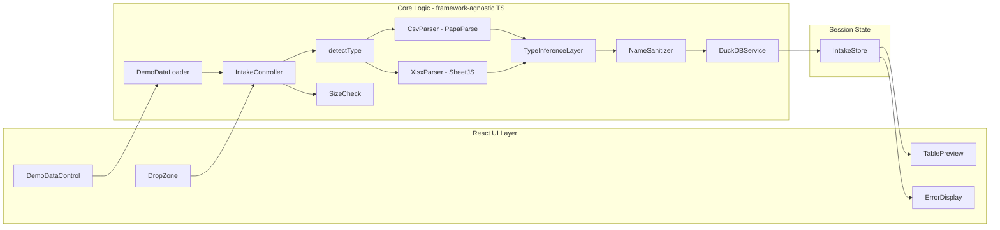

# Design Document — FrankenData File Intake

## Overview

This document describes the architecture and design for **Feature 1: File Intake** of FrankenData, a client-side mad-scientist-themed lab app for the Kiroween 2026 hackathon. The user drags and drops CSV or XLSX files (or loads bundled demo datasets); each file is parsed client-side, its columns are typed by a custom TypeScript inference layer that tolerates messy real-world values, and the result is loaded as a typed table in an in-memory DuckDB-WASM database. A preview of each table is rendered (first 20 rows, column names, inferred types, row count), and errors are surfaced clearly and non-blockingly.

Everything runs in the browser. There is no server, no persistence, and no PDF/AI/chat support — those belong to later specs.

## Goals and Scope

**In scope:**
- Drag-and-drop acceptance of any number of CSV/XLSX files (2–4 is the intended range; other counts are accepted with guidance).
- File type detection (extension) and size validation (25 MB limit).
- Client-side parsing with PapaParse (CSV) and SheetJS (XLSX), including Excel serial-date normalization.
- A custom TypeScript type inference layer that infers exactly one `ColumnType` (`number | boolean | date | string`) per column, tolerating currency symbols, thousands separators, surrounding whitespace, trailing percent signs, mixed date formats, and `NullToken` missing-value markers.
- Loading each parsed file as an explicitly typed table in an in-memory DuckDB-WASM database, with table- and column-name sanitization, uniqueness handling, and a string fallback when conversion to the inferred type fails.
- A per-table preview (first 20 rows, column names, inferred types, row count).
- Clear, non-blocking error handling (empty file, unsupported type, bad encoding, corrupt file, oversized file, load failure).
- A "Load demo data" control that loads three bundled messy demo datasets through the same pipeline with no network access.
- Property-based tests for parsing and type inference logic.
- React + Vite + TypeScript foundation with a spooky mad-scientist lab visual theme (contrast ≥ 4.5:1).

**Out of scope (later specs):** PDF support, AI matching, chat, persistence beyond the browser session.

## Architecture

FrankenData is a single-page React application. The file-intake feature is organized as a pipeline of pure-ish, framework-agnostic TypeScript modules behind a thin orchestration layer, with React components only at the edges (drop zone, preview, errors, demo control). Keeping parsing, type inference, name sanitization, and value coercion in pure TypeScript modules lets the core logic be unit- and property-tested without rendering React or spinning up DuckDB.

### High-level data flow

```
User drops files  ──or──  User clicks "Load demo data"
   │                                    │
   ▼                                    ▼
DropZone (React)                  DemoDataLoader ──┐
   │                                               │
   ▼                                               ▼
IntakeController  ◄── (shared pipeline)  ──────────┘
   │  for each file (independent try/catch):
   ▼
detectType(fileName) ──► unsupported? ──► IntakeError(unsupported-type)
   │
   ▼
sizeCheck(file.size) ──► > 25 MB? ──► IntakeError(oversized)
   │
   ▼
Parser.parse(file)   (CsvParser | XlsxParser)
   │  → ParsedFile { columnNames, rows }
   │  → empty / bad-encoding / corrupt? ──► IntakeError(...)
   ▼
TypeInferenceLayer.infer(columnNames, rows)
   │  → ColumnSchema[] (name + ColumnType); coerced cell values
   ▼
NameSanitizer.sanitizeTableName(fileName) + sanitizeColumnNames(columnNames)
   │  → tableName, columnNames (unique, valid)
   ▼
DuckDBService.createTable(tableName, schema, rows)
   │  conversion of a column fails? → reload that column as string (string fallback)
   │  other failure? ──► IntakeError(table-load-failed)
   ▼
IntakeStore (loaded tables + errors)  ──► TablePreview / ErrorDisplay (React)
```

### Component diagram



## Components and Interfaces

### UI Layer (React)

**DropZone** — Accepts dragged-and-dropped files. Highlights on drag-over (Req 1.1). On drop, forwards the `File[]` to the `IntakeController`. Shows the 2–4-files guidance message when the count is outside that range (Req 1.3).

**DemoDataControl** — Renders the "Load demo data" control alongside the DropZone (Req 13.1). On activation, invokes `DemoDataLoader`, which produces the three bundled demo datasets and feeds them through the `IntakeController` using the same pipeline as dropped files (Req 13.2).

**TablePreview** — Renders one card per loaded table: the first 20 rows, column names, inferred column types, and total row count (Req 7). Styled with the lab theme, readable headers, and visible column separators (Req 12.3).

**ErrorDisplay** — Renders the list of `IntakeError` entries in a panel that is visible without obscuring the table previews (Req 9.3). Each error names the file and describes the failure.

### Core Logic (framework-agnostic TypeScript)

**IntakeController** — Orchestrates the per-file pipeline. Processes each file independently in its own `try/catch` so a failure never halts the remaining files (Req 1.4, 9.2). Publishes results to `IntakeStore`. The same controller is used for dropped files and demo datasets.

**detectType** — Pure function: maps a file name's extension to a `FileType` (`csv | xlsx | unsupported`).

**SizeCheck** — Pure guard: rejects files larger than 25 MB with a named error stating the limit (Req 2.3).

**CsvParser** — Wraps PapaParse. Reads the file as text, parses into rows/columns, preserves the first row as column names. Detects empty files (zero data rows) and bad encodings (undecodable bytes).

**XlsxParser** — Wraps SheetJS. Reads the file as an `ArrayBuffer`, parses the first sheet, preserves the first row as column names. Detects empty workbooks (no sheets / zero data rows) and corrupt/unreadable files. Normalizes every cell value to a consistent string representation before it enters the type inference pipeline (Clarification 3): numbers → their string form, booleans → `"true"`/`"false"`, `Date` objects → an ISO `YYYY-MM-DD` string, and strings → as-is. For date cells where SheetJS returns an Excel serial date number, converts the serial to a calendar date and then to its ISO `YYYY-MM-DD` string form before type inference (Req 4.5). This guarantees the `TypeInferenceLayer` always receives string inputs regardless of the source cell format.

**TypeInferenceLayer** — Evaluates the non-null (non-`NullToken`) values of each column and infers exactly one `ColumnType` per column (Req 5). Does not rely on DuckDB auto-typing. Never throws (Req 5.10).

**NameSanitizer** — Pure module that derives a valid, unique DuckDB table name from a source file name (Req 6.1–6.3) and sanitizes column names (blank→generated, special chars→underscore, duplicate→unique suffix) (Req 6.4). Column-name uniqueness is checked **case-insensitively** (Clarification 2): two names that differ only in case (e.g., `Name` and `name`) are treated as duplicates and disambiguated with a numeric suffix.

**DuckDBService** — Owns the single in-memory DuckDB-WASM instance. Creates explicitly typed tables using the inferred schema (never auto-typing), inserts all rows with values coerced to the column's DuckDB type, and serves preview/count queries. Falls back to `VARCHAR` for a column whose conversion fails (Req 6.7). Produces a `LoadedTable` descriptor and surfaces load failures.

**DemoDataLoader** — Provides the three bundled `DemoDataset` fixtures as in-memory `File`-like inputs (or direct `ParsedFile`s) containing intentionally messy values (currency, percent, `NullToken`s, multiple date formats) (Req 13.3). Bundled so loading requires no network access (Req 13.4). Routes through the `IntakeController` so demo data uses the identical parsing/inference/loading pipeline.

### Session State

**IntakeStore** — Holds the list of `LoadedTable` descriptors and `IntakeError` entries for the current session only. No persistence: refreshing the page recreates an empty store and a fresh DuckDB instance (Req 8).

### Module Interfaces

All core modules expose typed interfaces so they can be tested without React or the DOM.

```ts
// The four supported inferred types (Req 5.3).
export type ColumnType = "number" | "boolean" | "date" | "string";

// A file type detected purely from extension.
export type FileType = "csv" | "xlsx" | "unsupported";

// A single column's resolved schema.
export interface ColumnSchema {
  name: string;
  type: ColumnType;
}

// A cell value as it comes out of the parser (always string-typed; both parsers
// normalize cell values to strings — incl. XLSX numbers/booleans/Date objects —
// before type inference, and typing/coercion to DuckDB types happens later).
export type CellValue = string | null;

// The result of parsing a file, before typing.
export interface ParsedFile {
  sourceFileName: string;
  columnNames: string[]; // from the first row (CSV) / first row of first sheet (XLSX)
  rows: CellValue[][];   // data rows only, aligned with columnNames
}

// A successfully loaded table.
export interface LoadedTable {
  tableName: string;       // valid, unique DuckDB identifier derived from sourceFileName
  sourceFileName: string;
  schema: ColumnSchema[];  // the inferred types actually used to create the table
  rowCount: number;        // total data rows inserted
}

// A per-file failure captured during the pipeline.
export interface IntakeError {
  sourceFileName: string;
  stage: "validation" | "parsing" | "type-inference" | "loading";
  message: string; // human-readable, describes the failure
  kind:
    | "unsupported-type"
    | "oversized"
    | "empty-file"
    | "bad-encoding"
    | "corrupt-file"
    | "table-load-failed";
}

// Parser abstraction shared by CSV and XLSX parsers.
export interface FileParser {
  readonly fileType: FileType;
  parse(file: File): Promise<ParsedFile>;
}

// Extension-to-file-type detection (pure).
export function detectType(fileName: string): FileType;

// Size guard (pure): returns null if ok, else an oversized error descriptor.
export function checkSize(fileSizeBytes: number, fileName: string): IntakeError | null;

// Type inference (pure over its inputs; never throws).
export interface TypeInferenceLayer {
  infer(columnNames: string[], rows: CellValue[][]): ColumnSchema[];
}

// Name sanitization (pure).
export interface NameSanitizer {
  sanitizeTableName(sourceFileName: string, existingNames: string[]): string;
  sanitizeColumnNames(columnNames: string[]): string[];
}

// DuckDB lifecycle + table operations.
export interface DuckDBService {
  init(): Promise<void>;
  createTable(
    tableName: string,
    schema: ColumnSchema[],
    rows: CellValue[][]
  ): Promise<LoadedTable>;
  getRowCount(tableName: string): Promise<number>;
  getPreviewRows(tableName: string, limit: number): Promise<Record<string, unknown>[]>;
  query<T = Record<string, unknown>>(sql: string): Promise<T[]>;
}

// Bundled demo datasets (no network access).
export interface DemoDataLoader {
  load(): Promise<File[]>; // three demo files routed through the shared pipeline
}

// Orchestration entry point.
export interface IntakeController {
  intake(files: File[]): Promise<void>;
}
```

## Data Models

### ColumnType → DuckDB type mapping

The TypeInferenceLayer's `ColumnType` is mapped to an explicit DuckDB column type when the table is created. This is the mechanism by which we honor "create using the ColumnType values rather than relying on DuckDB auto-typing" (Req 6.5).

| ColumnType | DuckDB type |
|------------|-------------|
| `number`   | `DOUBLE`    |
| `boolean`  | `BOOLEAN`   |
| `date`     | `DATE`      |
| `string`   | `VARCHAR`   |

When inserting, cell values are coerced to match the column's DuckDB type (e.g., `null` stays `NULL`, numeric strings become `DOUBLE`, boolean literals become `BOOLEAN`, date strings are normalized to ISO `YYYY-MM-DD` and become `DATE`, everything else stays `VARCHAR`).

### NullToken model

A `NullToken` is any cell value that represents missing data, matched **case-insensitively after trimming surrounding whitespace** (Req 5.2):

- An empty cell (`""` or whitespace-only).
- The literal text: `N/A`, `NA`, `null`.
- A single hyphen: `-`.

`NullToken`s are excluded from type inference and stored as SQL `NULL`. A column containing only `NullToken`s is inferred as `string` (Req 5.9).

### Table name derivation

The DuckDB table name is derived from the source file name and sanitized into a valid identifier (Req 6.1, 6.2):

1. Strip the directory and extension: `data/Sales 2024.csv` → `Sales 2024`.
2. Replace every non-`[A-Za-z0-9_]` character with `_`.
3. Collapse consecutive underscores.
4. Lowercase.
5. If the result starts with a digit, prefix `t_`.
6. If the result is empty or collides with an existing table name, append a numeric suffix (`_2`, `_3`, …) (Req 6.3).

Example: `Sales 2024.csv` → `sales_2024`; `1st-batch.xlsx` → `t_1st_batch`.

### Column name sanitization

Column names from the parsed header are sanitized into valid, unique DuckDB column names (Req 6.4):

1. Replace blank/empty names with a generated name (`column_1`, `column_2`, … by position).
2. Replace spaces and special (non-`[A-Za-z0-9_]`) characters with `_`.
3. Make duplicate names unique by appending a numeric suffix (`_2`, `_3`, …), preserving the first occurrence. Uniqueness is checked **case-insensitively** (Clarification 2): names that differ only in case (e.g., `Name` and `name`) are treated as the same name, so the first occurrence keeps its casing (`Name`) and the later occurrence receives a suffix (`name_2`).

## Type Inference Algorithm

The TypeInferenceLayer evaluates the non-`NullToken` values of each column and classifies each column as exactly one `ColumnType` (Req 5.1, 5.3). `NullToken`s are excluded from classification (Req 5.2).

### Per-value parseability predicates

- **isNumber(v)** — `v` (trimmed) is a parsable number after stripping optional surrounding whitespace, a leading currency symbol (`$`, `€`, `£`, `₹`, and the words `EUR`/`GBP`/`INR`), thousands-separator commas, and an optional trailing percent sign (Req 5.4). A trailing percent sign converts the value to its decimal fraction (Req 5.5): `12%` → `0.12`. Pure numeric strings (`42`, `-3.14`, `1e3`, `0`) also satisfy this.
- **isBoolean(v)** — `v` matches `^(true|false|yes|no)$` case-insensitively after trimming (Req 5.6). Bare `0`/`1` are **not** booleans (they are numbers), keeping the predicates non-overlapping.
- **isDate(v)** — `v` (always a string, since both parsers normalize cell values to strings before inference) matches a recognized date format and parses to a valid calendar date (Req 5.7): ISO 8601 (`YYYY-MM-DD`), `MM/DD/YYYY` (month-first; slashes are read as `MM/DD/YYYY`, **not** `DD/MM/YYYY`), `DD-MM-YYYY` (day-first, dash-separated), or a month-name format such as `Jan 5, 2026`. A bare 4-digit year like `2023` is **not** a date (it is a number).

### Column classification

For a column's non-`NullToken` values:

1. If **every** value satisfies `isNumber` → `number`.
2. Else if **every** value satisfies `isBoolean` → `boolean`.
3. Else if **every** value satisfies `isDate` → `date`.
4. Else → `string` (mixed or unparseable) (Req 5.8).

If a column has **zero** non-`NullToken` values (all `NullToken`s), it is classified as `string` (Req 5.9).

The predicates are defined to be mutually exclusive over any single value, so the check order does not produce ambiguous results for uniform columns; mixed columns always fall through to `string`. The layer returns a `ColumnType` for any input without throwing (Req 5.10).

### Date normalization to ISO

Every value recognized as a date (by `isDate`) is normalized to its canonical ISO `YYYY-MM-DD` representation before it is inserted into the DuckDB `DATE` column (Clarification 1). This normalization runs in the value-coercion step (not during inference) and applies uniformly to all recognized date formats — ISO 8601 (`YYYY-MM-DD`), `MM/DD/YYYY` (month-first; slashes are read as `MM/DD/YYYY`, never `DD/MM/YYYY`), `DD-MM-YYYY` (day-first, dash-separated), and month-name formats — so that regardless of the source format, the stored `DATE` value is the correct calendar date in ISO form. For columns inferred as `date`, every non-`NullToken` cell is converted to ISO `YYYY-MM-DD` during insertion; an already-ISO value maps to itself, so normalization is idempotent.

## DuckDB-WASM Integration

- **Initialization** — A single `@duckdb/duckdb-wasm` instance is created once on app start, configured for in-memory operation with no persistent backing store (Req 8.1, 11.2). The instance lives in module scope for the browser session.
- **Table creation** — `createTable` issues `CREATE TABLE "name" (col1 DOUBLE, col2 VARCHAR, …)` using the inferred `ColumnSchema`, never relying on `CREATE TABLE … AS SELECT` auto-typing (Req 6.5).
- **Insertion** — Rows are inserted in batches via parameterized statements/appender, with values coerced to the column's DuckDB type. For `date` columns, each recognized date value is normalized to its canonical ISO `YYYY-MM-DD` string before being inserted into the `DATE` column (Clarification 1); `null` stays `NULL`, numeric strings become `DOUBLE`, boolean literals become `BOOLEAN`, and other values stay `VARCHAR`. The number of inserted rows is asserted to equal the parsed data row count (Req 6.6).
- **String fallback** — If converting a column's values to its inferred DuckDB type fails during loading, that column is recreated/loaded as `VARCHAR` and the file still loads (Req 6.7).
- **Preview queries** — `getPreviewRows(name, 20)` runs `SELECT * FROM "name" LIMIT 20`; `getRowCount(name)` runs `SELECT COUNT(*) FROM "name"`. These feed the `TablePreview` (Req 7).
- **Lifecycle** — On page refresh/close the WASM instance and all tables are discarded by the browser; nothing is written to IndexedDB or any other store (Req 8.2, 8.3).

## Demo Data

The three `DemoDataset`s are bundled as static assets (e.g., CSV strings embedded in the bundle) so loading them requires no network access (Req 13.4). Each contains intentionally messy values (Req 13.3):

- Currency-formatted numbers (e.g., `$1,234.56`, `€9.99`).
- Percent values (e.g., `12%`).
- `NullToken`s in various forms (e.g., `N/A`, `-`, empty cells).
- Dates in more than one format (e.g., `2026-01-05`, `01/05/2026`, `Jan 5, 2026`).

Activating the "Load demo data" control invokes `DemoDataLoader.load()`, which returns three `File` objects (constructed from the bundled data) and routes them through the same `IntakeController` pipeline used for dropped files (Req 13.2).

## Error Handling

Every file is processed inside its own `try/catch` in the `IntakeController`. A failure produces an `IntakeError` that names the file, identifies the stage, and carries a human-readable message; it is added to the store and processing continues with the next file (Req 9.1, 9.2). Errors render in a dedicated panel that does not obscure previews (Req 9.3).

Error kinds and where they originate:

| Kind                | Stage         | Trigger                                                        |
|---------------------|---------------|----------------------------------------------------------------|
| `unsupported-type`  | validation    | Extension is not `.csv` or `.xlsx` (Req 2.2)                   |
| `oversized`         | validation    | File larger than 25 MB (Req 2.3)                                |
| `empty-file`        | parsing       | CSV with zero data rows, or XLSX with no sheets / zero rows (Req 3.2, 4.2) |
| `bad-encoding`      | parsing       | CSV bytes cannot be decoded as text (Req 3.3)                  |
| `corrupt-file`      | parsing       | XLSX is unreadable/corrupt (Req 4.3)                            |
| `table-load-failed` | loading       | DuckDB `CREATE TABLE`/insertion fails for reasons other than the string-fallback case (Req 6.8) |

## Visual Theme (Spooky Mad-Scientist Lab)

- Dark lab background with a restrained palette of laboratory greens, purples, and amber accents.
- Body text rendered in a high-contrast light tone against the dark background to meet a contrast ratio of at least 4.5:1 (Req 12.2). Theme color tokens are defined once so contrast can be checked against the defined pairs.
- DropZone styled as a lab "intake port" with a clear drag-over highlight state (Req 1.1).
- TablePreview renders with visible column separators and sticky, readable headers against the themed background (Req 12.3).

The theme is presentation-only; it does not affect the core parsing/typing/loading logic, which remains pure and independently testable.

## Testing Strategy

**Dual approach:** example-based unit tests for specific scenarios/edges/integration points, and property-based tests for universal invariants.

- **Unit tests** cover: drag-over highlight, demo control presence, preview rendering presence, theme contrast over the defined color-token pairs, and integration points (parser → inference → DuckDB round trip with a couple of representative files, plus demo-data loading through the pipeline).
- **Property-based tests** use a generator-based library (e.g., `fast-check`) with a minimum of 100 iterations per property. Generators produce: arbitrary row/column counts, arbitrary cell contents, all-number (incl. currency/thousands/percent) / all-boolean (incl. yes/no) / all-date (incl. month-name) / mixed / all-NullToken columns, date values across all recognized formats (for ISO-normalization, incl. `MM/DD/YYYY` month-first, `DD-MM-YYYY` day-first, and month-name), XLSX cell values of each SheetJS type (number, boolean, `Date` object, string), arbitrary file names, arbitrary extensions, arbitrary file sizes, empty/corrupt inputs, and arbitrary strings (for the no-throw property).
- Each property test references its design property by tag: **Feature: frankendata-file-intake, Property {n}: {title}**.

Property tests target the framework-agnostic core modules (`detectType`, `checkSize`, parsers, `TypeInferenceLayer`, `NameSanitizer`, number-format parse/print helpers) so they run quickly and deterministically without a browser or DuckDB where possible. DuckDB-backed properties (row-count preservation, typed-table creation, string fallback) use the in-memory DuckDB instance with small generated tables.

## Correctness Properties

*A property is a characteristic or behavior that should hold true across all valid executions of a system—essentially, a formal statement about what the system should do. Properties serve as the bridge between human-readable specifications and machine-verifiable correctness guarantees.*

### Property 1: CSV parsing fidelity

*For any* valid CSV input of any row and column count, parsing produces the expected rows and columns, and the parsed column names equal the first row of the CSV.

**Validates: Requirements 3.1, 3.4, 10.1**

### Property 2: XLSX parsing fidelity

*For any* valid XLSX input of any row and column count, parsing produces the expected rows and columns, and the parsed column names equal the first row of the first sheet.

**Validates: Requirements 4.1, 4.4, 10.2**

### Property 3: Empty file detection

*For any* CSV with zero data rows, or *for any* XLSX with no sheets or zero data rows, the system reports an empty-file error that names the file.

**Validates: Requirements 3.2, 4.2**

### Property 4: Unreadable file detection

*For any* CSV whose bytes cannot be decoded, or *for any* corrupt/unreadable XLSX, the system reports a read error that names the file.

**Validates: Requirements 3.3, 4.3**

### Property 5: Excel serial date conversion

*For any* Excel serial date number, conversion to a calendar date yields the correct calendar date (round-trippable against the Excel epoch), and the result is normalized to a string in ISO `YYYY-MM-DD` form before entering type inference.

**Validates: Requirements 4.5**

### Property 6: File type routing from extension

*For any* dropped file, the detected type and selected parser are determined solely by the file extension: `.csv` selects the CSV (PapaParse) parser, `.xlsx` selects the XLSX (SheetJS) parser, and any other extension is marked unsupported with an error naming the file.

**Validates: Requirements 2.1, 2.2**

### Property 7: File size limit enforcement

*For any* file whose size exceeds 25 MB, the file is skipped and an error names the file and states the 25 MB limit; *for any* file at or below 25 MB, no size error is produced.

**Validates: Requirements 2.3**

### Property 8: Accept all dropped files

*For any* number of dropped files, every dropped file is accepted for processing regardless of the count.

**Validates: Requirements 1.2**

### Property 9: File-count guidance message

*For any* dropped file count, the informational "2 to 4 files is intended" message is displayed if and only if the count is outside the 2–4 range.

**Validates: Requirements 1.3**

### Property 10: Independent processing and failure isolation

*For any* set of dropped files, processing each file is independent: a failure in one file does not prevent the remaining files from being processed, and each file's outcome equals its standalone outcome regardless of the order or presence of the other files.

**Validates: Requirements 1.4, 9.2**

### Property 11: Type inference total classification

*For any* column, the inferred `ColumnType` is exactly one of `number`, `boolean`, `date`, or `string` (never zero, never more than one).

**Validates: Requirements 5.3**

### Property 12: NullToken exclusion and NULL storage

*For any* column, every `NullToken` (empty cell, `N/A`, `NA`, `null`, or a single hyphen, case-insensitive after trimming) is excluded from type inference and stored as SQL `NULL`.

**Validates: Requirements 5.2**

### Property 13: All-numbers infer number (including NullToken-mixed columns)

*For any* column whose non-`NullToken` values all parse as numbers — including currency symbols, thousands separators, surrounding whitespace, and trailing percent signs — the inferred `ColumnType` is `number`. This holds for columns that mix `NullToken`s with numbers, because `NullToken`s are excluded from inference.

**Validates: Requirements 5.4, 10.3, 10.9**

### Property 14: Percent-to-decimal conversion

*For any* number value with a trailing percent sign, the converted value equals the numeric portion divided by 100 (e.g., `12%` becomes `0.12`).

**Validates: Requirements 5.5**

### Property 15: Number formatting round trip

*For any* number, formatting it with a currency symbol, thousands separators, or surrounding whitespace and then parsing it back yields the same numeric value.

**Validates: Requirements 10.7**

### Property 16: All-booleans infer boolean

*For any* column whose non-`NullToken` values are all one of `true`, `false`, `yes`, or `no` (case-insensitive), the inferred `ColumnType` is `boolean`.

**Validates: Requirements 5.6, 10.4**

### Property 17: All-dates infer date

*For any* column whose non-`NullToken` values all parse as dates in ISO 8601 (`YYYY-MM-DD`), `MM/DD/YYYY` (month-first; slashes read as `MM/DD/YYYY`, not `DD/MM/YYYY`), `DD-MM-YYYY` (day-first, dash-separated), or a month-name format, the inferred `ColumnType` is `date`.

**Validates: Requirements 5.7, 10.5**

### Property 18: Mixed or unparseable infer string

*For any* column whose non-`NullToken` values are of mixed or unparseable types, the inferred `ColumnType` is `string`.

**Validates: Requirements 5.8, 10.6**

### Property 19: All-NullToken column infers string

*For any* column containing only `NullToken`s, the inferred `ColumnType` is `string`.

**Validates: Requirements 5.9**

### Property 20: Inference never throws

*For any* arbitrary string input (including malformed, very long, or non-printable strings), the TypeInferenceLayer returns a `ColumnType` without throwing an exception.

**Validates: Requirements 5.10, 10.8**

### Property 21: Table name derivation and sanitization

*For any* source file name, the derived DuckDB table name is a valid identifier with spaces/symbols replaced by underscores, no leading digit, and no file extension.

**Validates: Requirements 6.1, 6.2**

### Property 22: Table name uniqueness

*For any* set of source file names that would produce the same sanitized table name, the resulting table names are all unique via numeric suffixes.

**Validates: Requirements 6.3**

### Property 23: Column name sanitization

*For any* set of parsed column names, sanitization replaces blank names with generated names, replaces spaces and special characters with underscores, and makes duplicate names unique with numeric suffixes. Uniqueness is checked case-insensitively: names that differ only in case (e.g., `Name` and `name`) are treated as duplicates and disambiguated with a suffix.

**Validates: Requirements 6.4**

### Property 24: DuckDB table uses inferred types

*For any* loaded table, each column's DuckDB column type matches the `ColumnType` produced by the TypeInferenceLayer (i.e., the table is created with explicit typed columns, not via DuckDB auto-typing).

**Validates: Requirements 6.5**

### Property 25: Row count preservation

*For any* parsed file, the number of rows inserted into the DuckDB table equals the number of parsed data rows.

**Validates: Requirements 6.6**

### Property 26: String fallback on conversion failure

*For any* column where converting its values to the inferred `ColumnType` fails during loading, that column is loaded as `string` and the file still loads successfully.

**Validates: Requirements 6.7**

### Property 27: Load failure error names the file

*For any* file that fails to parse, type-infer, or load for reasons other than the string-fallback case, the displayed error message names that file and describes the failure.

**Validates: Requirements 6.8, 9.1**

### Property 28: Preview completeness

*For any* loaded table, the TablePreview displays exactly the first `min(rowCount, 20)` rows, all column names, the inferred `ColumnType` of each column, and the total row count.

**Validates: Requirements 7.2, 7.3, 7.4, 7.5**

### Property 29: Date normalization to ISO YYYY-MM-DD

*For any* value recognized as a date in any recognized format — ISO 8601 (`YYYY-MM-DD`), `MM/DD/YYYY` (month-first; slashes read as `MM/DD/YYYY`, not `DD/MM/YYYY`), `DD-MM-YYYY` (day-first, dash-separated), or a month-name format such as `Jan 5, 2026` — the value-coercion step normalizes it to the correct calendar date in canonical ISO `YYYY-MM-DD` form before it is inserted into the DuckDB `DATE` column. Normalization is idempotent: an already-ISO value maps to itself.

**Validates: Requirements 4.5, 5.7**

### Property 30: XLSX cell value string normalization

*For any* XLSX cell value returned by SheetJS as a number, boolean, `Date` object, or string, the `XlsxParser` normalizes it to a consistent string representation before it enters the type inference pipeline (numbers → string form, booleans → `"true"`/`"false"`, `Date` objects and Excel serial dates → ISO `YYYY-MM-DD` string, strings → as-is), so the `TypeInferenceLayer` always receives string inputs regardless of the source cell format.

**Validates: Requirements 4.1, 4.5**

## Non-Property Test Coverage

The following acceptance criteria are not amenable to property-based testing and are covered by example-based, smoke, or integration tests instead:

- **1.1** (drag-over highlight) — example-based UI test.
- **7.1** (preview shown on load) — example-based UI test.
- **8.1, 8.3** (in-memory, no persistence) — smoke tests asserting configuration has no persistent backing store.
- **8.2** (state resets on refresh) — integration test over session lifecycle.
- **9.3** (errors visible without obscuring previews) — example-based layout test.
- **11.1, 11.2, 11.3** (tech-stack foundation) — smoke tests asserting the toolchain and client-side wiring.
- **12.1, 12.3** (theme application, table styling) — visual review / snapshot example tests.
- **12.2** (contrast ratio ≥ 4.5:1) — example-based test over the defined theme color-token pairs.
- **13.1** (demo control present) — example-based UI test.
- **13.2** (demo data loads through the pipeline) — integration test (1–3 examples) asserting the three bundled datasets load via the shared pipeline.
- **13.3** (demo data contains messy values) — example test inspecting the bundled fixtures.
- **13.4** (demo data bundled, no network) — smoke test asserting datasets are bundled and require no network access.
